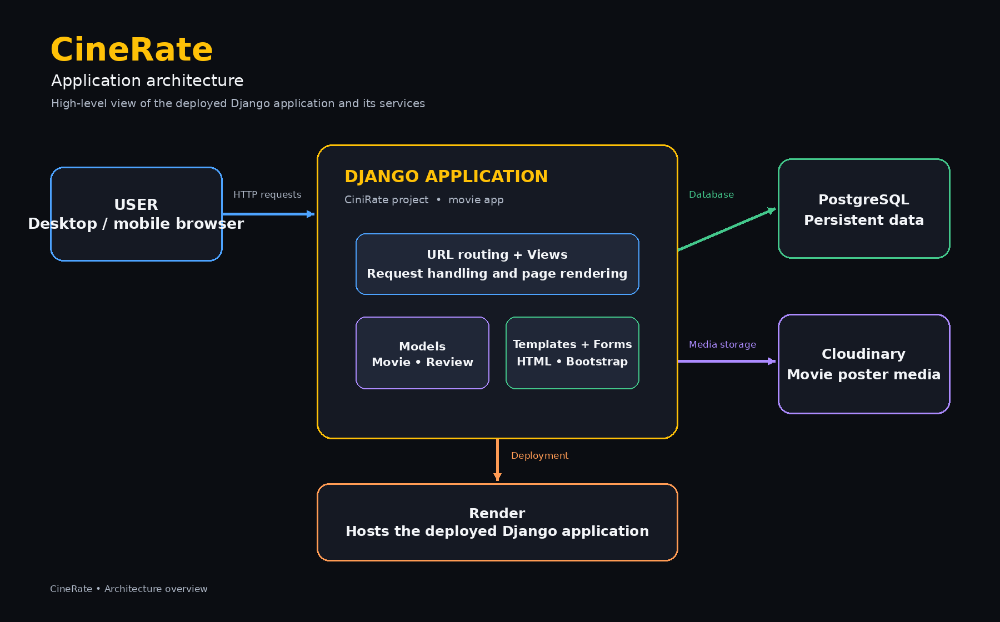
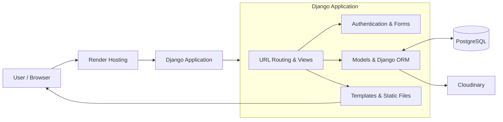
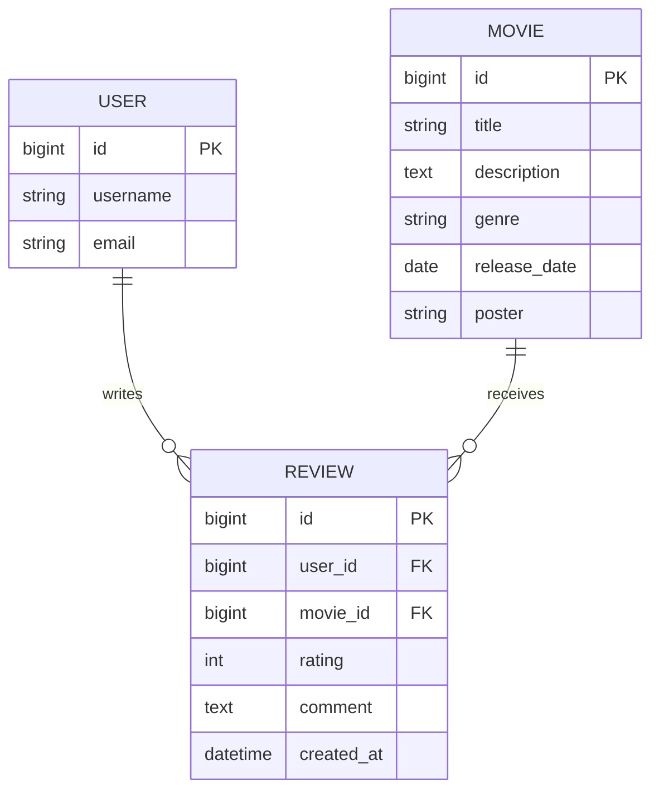
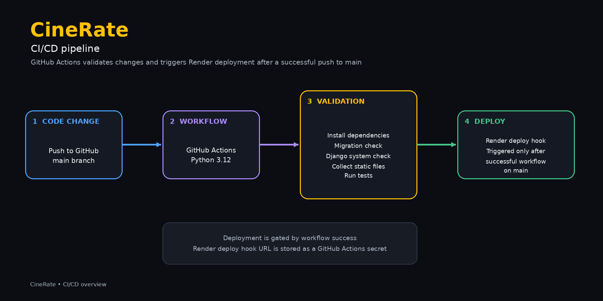

# CineRate

**A better way to discover, rate, and review movies.**

CineRate is a full-stack movie discovery and review platform built with Python and Django. It brings movie browsing, community ratings, and user reviews together in one responsive application.

**Live Application:** https://cinerate-ojlp.onrender.com/

---

**TECHNOLOGY**

`Python 3.12` · `Django 5` · `PostgreSQL` · `Bootstrap 5` · `Cloudinary` · `GitHub Actions` · `Render`

---

---

## Overview

**CineRate** is a full-stack web application that combines movie discovery with community-driven ratings and reviews.

Users can browse movies, explore average ratings, write reviews, and manage their own contributions through a responsive interface.

Originally developed during a Python Full-Stack Development training program, the project was extended into a deployed application with relational database integration, cloud-based poster storage, and an automated CI/CD workflow.

## Application Screenshots

### Desktop Experience


### Mobile Experience


---

## Key Features

| Feature | Description |
|---|---|
| Movie Discovery | Browse movies with posters, descriptions, genres, and release dates |
| User Authentication | Register, log in, and log out |
| Movie Ratings | Rate movies from 1 to 5 stars |
| Average Ratings | View average ratings calculated from submitted reviews |
| Review Management | Create, edit, and delete your own reviews |
| Movie Management | Staff-authorized movie uploads |
| Search and Filtering | Search by movie title and explore genre and rating filters |
| Responsive Interface | Dedicated desktop and mobile layouts |
| Theme Switching | Switch between dark and light themes |
| Movie Sharing | Share movie pages or copy their links |
| Cloud Image Storage | Store uploaded movie posters using Cloudinary |

---

## Technology Stack

| Layer | Technologies |
|---|---|
| Language | Python 3.12 |
| Backend | Django |
| Database | PostgreSQL, SQLite |
| Frontend | HTML5, CSS3, JavaScript |
| UI Framework | Bootstrap 5 |
| Database Access | Django ORM |
| Media Storage | Cloudinary |
| Application Server | Gunicorn |
| Static File Handling | WhiteNoise |
| CI/CD | GitHub Actions |
| Deployment | Render |
| Version Control | Git, GitHub |

---

## System Architecture

CineRate uses Django to handle application requests, authentication, movie and review operations, and communication with its external services.



### Architecture Flow



### Database Design

CineRate uses Django's built-in user model and two primary application models: `Movie` and `Review`.

- **Movie:** Stores the title, description, genre, release date, and poster.
- **Review:** Stores the associated user, movie, rating, comment, and creation timestamp.
- **User:** Uses Django authentication to manage user accounts.

Each review belongs to one user and one movie. A uniqueness constraint prevents a user from submitting multiple reviews for the same movie.



---

## CI/CD and Deployment

CineRate uses **GitHub Actions** to automate application validation and production deployment.

The workflow runs on pushes and pull requests targeting `main`. Production deployment is triggered only after successful validation on a push to `main`.



### Workflow Stages

1. Check out the repository.
2. Set up Python 3.12.
3. Install project dependencies.
4. Verify that no uncreated database migrations exist.
5. Run Django system checks.
6. Test static file collection.
7. Execute the Django test suite.
8. Trigger the Render deployment hook after successful validation on pushes to `main`.

The Render deployment hook URL is stored securely as a GitHub Actions secret named `RENDER_DEPLOY_HOOK_URL`.

---

## Run Locally

### 1. Clone the repository

```bash
git clone https://github.com/satyammishra8-1/CineRate.git
cd CineRate
```

### 2. Create and activate a virtual environment

```bash
python -m venv venv
```

**Windows:**

```bash
venv\Scripts\activate
```

**macOS / Linux:**

```bash
source venv/bin/activate
```

### 3. Install dependencies

```bash
pip install -r requirements.txt
```

### 4. Configure environment variables

Configure the following variables in your environment:

| Variable | Purpose |
|---|---|
| `SECRET_KEY` | Django secret key |
| `DEBUG` | Django debug setting (`True` or `False`) |
| `DATABASE_URL` | PostgreSQL connection URL |
| `CLOUDINARY_CLOUD_NAME` | Cloudinary cloud name |
| `CLOUDINARY_API_KEY` | Cloudinary API key |
| `CLOUDINARY_API_SECRET` | Cloudinary API secret |

**Database configuration:** If `DATABASE_URL` is not provided, the application uses SQLite by default. When a valid database URL is supplied, it uses the configured database.

For real Cloudinary media uploads, configure your own Cloudinary credentials. Never commit secrets or production credentials to GitHub.

### 5. Apply database migrations

```bash
python manage.py migrate
```

### 6. Create an administrator account (optional)

```bash
python manage.py createsuperuser
```

### 7. Start the development server

```bash
python manage.py runserver
```

Open:

`http://127.0.0.1:8000/`

---

## Testing

Run the application tests:

```bash
python manage.py test movie
```

The same test command is included in the GitHub Actions workflow.

---

## Project Structure

```text
CineRate/
│
├── .github/
│   └── workflows/
│       └── ci-cd.yml
│
├── CiniRate/
│   ├── settings.py
│   ├── urls.py
│   ├── asgi.py
│   └── wsgi.py
│
├── movie/
│   ├── migrations/
│   ├── static/
│   ├── templates/
│   ├── admin.py
│   ├── forms.py
│   ├── models.py
│   ├── urls.py
│   ├── views.py
│   └── tests.py
│
├── screenshots/
│   ├── desktop-showcase.png
│   └── mobile-showcase.png
│
├── diagrams/
│   ├── architecture.png
│   └── cicd-pipeline.png
│
├── manage.py
├── requirements.txt
└── .gitignore
```

---

## Engineering Experience

Working on CineRate provided practical experience with:

- Building a full-stack web application using Python and Django.
- Implementing authentication and authorization.
- Designing relational data models and ORM relationships.
- Integrating PostgreSQL and Cloudinary.
- Developing responsive desktop and mobile interfaces.
- Deploying a Django application on Render.
- Configuring automated validation and deployment using GitHub Actions.

## Future Improvements

- Personalized movie recommendation system.
- Advanced movie discovery and filtering.
- Pagination and database query optimization.
- Expanded automated test coverage.
- User profiles and enhanced review interactions.

---

## Developer

**Satyam Mishra**

Computer Science and Engineering Student | Full-Stack Developer

<p>
  <a href="https://github.com/satyammishra8-1">
    
  </a>
  <a href="https://www.linkedin.com/in/satyam-mishra-42b806404/">
    
  </a>
</p>

**Live Project:** [CineRate](https://cinerate-ojlp.onrender.com/)

---

<p align="center">
  <strong>Built with Python, Django, and a passion for creating useful web applications.</strong>
</p>
