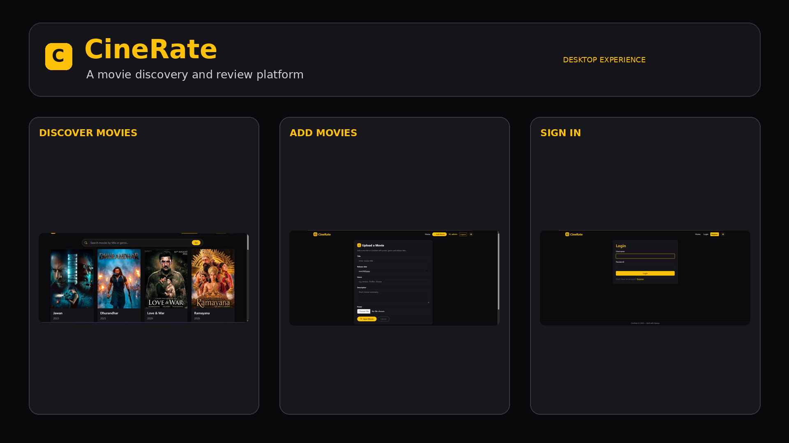
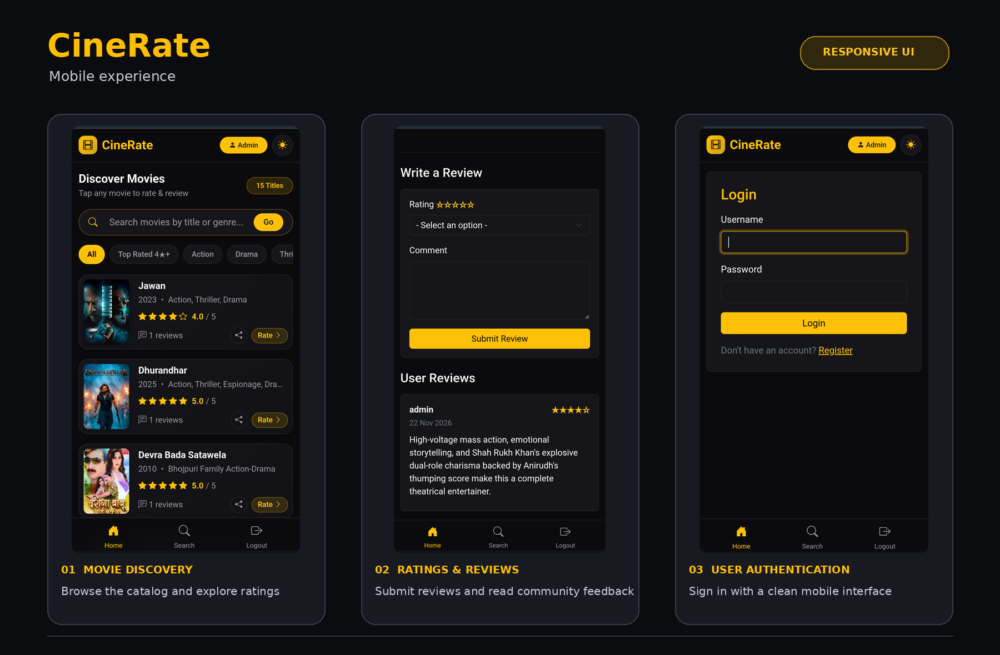
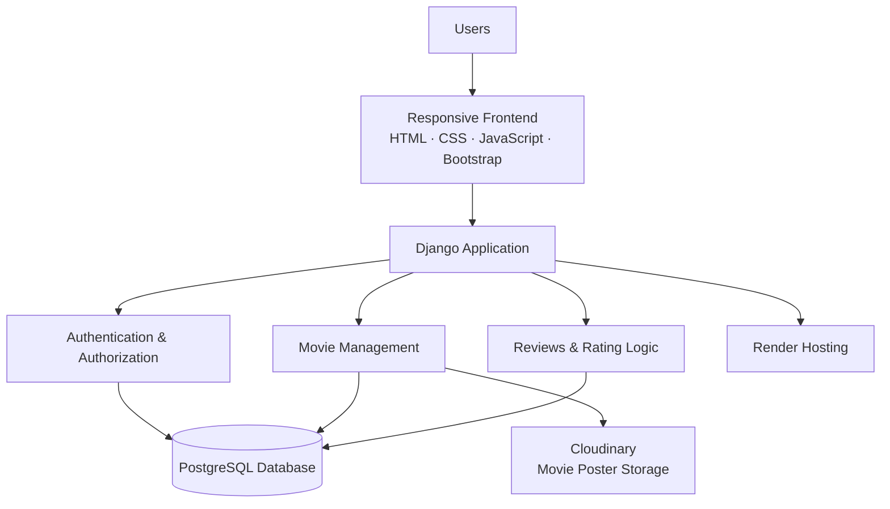
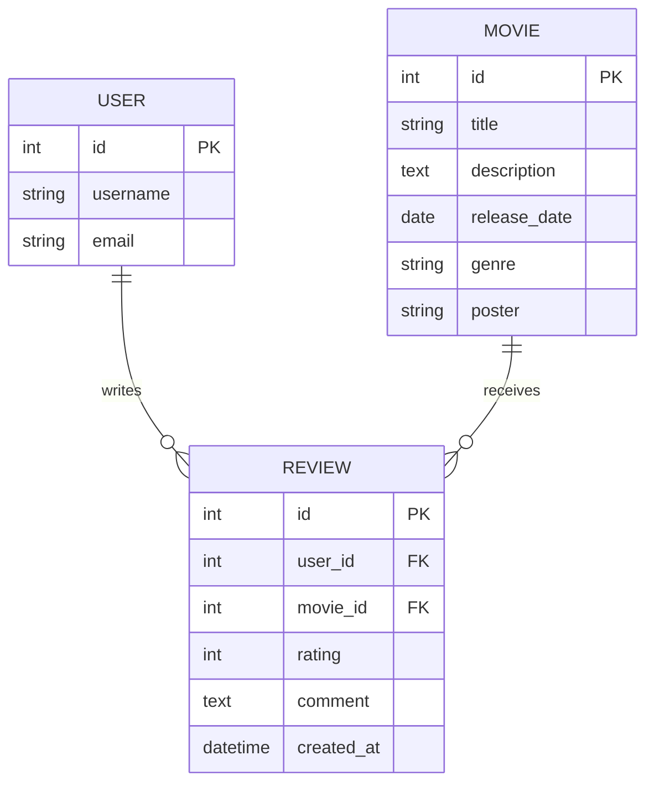
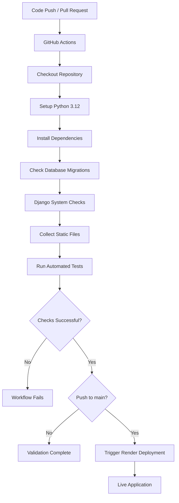

# CineRate

### Discover Movies. Rate Experiences. Share Opinions.

A full-stack movie discovery and review platform built with **Python, Django, and PostgreSQL**. Discover movies, explore ratings, and share your opinions through a clean, responsive interface.

<p align="center">
  <a href="https://cinerate-ojlp.onrender.com/">
    
  </a>
</p>

<p align="center">
  
  
  
  
</p>

---

## 📌 Overview

**CineRate** is a responsive full-stack web application that brings movie discovery and community-driven reviews together.

Users can explore movies, view average ratings, write reviews, and share their opinions through a modern interface designed for both desktop and mobile devices.

Developed as part of a Python Full-Stack Development training program, CineRate evolved into a deployed application involving backend engineering, relational database integration, cloud image storage, and automated CI/CD deployment.

## 🖥️ Application Preview

### Desktop Experience

<!-- Add your desktop showcase image here -->


*Explore movies, discover ratings, and interact with the platform on desktop.*

### Mobile Experience

<!-- Add your mobile showcase image here -->


*Responsive movie discovery and review experience optimized for mobile devices.*

---

## ✨ Key Features

| Feature | Description |
|---|---|
| 🎬 Movie Discovery | Browse movies with posters, descriptions, genres, and release dates. |
| 🔐 Authentication | User registration, login, and logout functionality. |
| ⭐ Rating System | Submit ratings from 1 to 5 stars and view average movie ratings. |
| 💬 Review System | Write and read community movie reviews. |
| ✏️ Review Management | Edit or delete your own reviews. |
| 🛠️ Movie Management | Staff-authorized movie uploads. |
| 🔎 Search & Filtering | Search movies by title and filter by genre or rating. |
| 📱 Responsive UI | Dedicated mobile and desktop layouts. |
| 🌗 Theme Switching | Switch between dark and light modes. |
| 🔗 Movie Sharing | Share movie pages using native sharing or clipboard functionality. |
| ☁️ Cloud Image Storage | Store movie poster images using Cloudinary. |

---

## 🛠️ Technology Stack

| Layer | Technologies |
|---|---|
| Programming Language | Python |
| Backend Framework | Django |
| Database | PostgreSQL, SQLite |
| Frontend | HTML5, CSS3, JavaScript |
| UI Framework | Bootstrap 5 |
| ORM | Django ORM |
| Image Storage | Cloudinary |
| Application Server | Gunicorn |
| Static File Serving | WhiteNoise |
| CI/CD | GitHub Actions |
| Deployment | Render |
| Version Control | Git & GitHub |

---

## 🏗️ System Architecture

CineRate follows a Django-based architecture connecting the user interface, application logic, database, and cloud image storage.



### Database Design

The application uses two primary models:

- **Movie:** Stores movie title, description, release date, genre, and poster.
- **Review:** Stores the user, associated movie, rating, comment, and creation timestamp.

Each review belongs to one user and one movie. A database-level uniqueness constraint prevents the same user from reviewing the same movie more than once.



---

## ⚙️ CI/CD & Deployment

CineRate implements an automated CI/CD workflow using **GitHub Actions**.

The workflow validates application changes before triggering production deployment.

### Pipeline



### Automated Workflow Includes

- Python environment setup.
- Dependency installation.
- Database migration validation.
- Django system checks.
- Static file collection.
- Automated Django test execution.
- Render deployment triggering after successful checks on pushes to `main`.

---

## 🚀 Run Locally

Follow these steps to run CineRate on your local machine.

### 1. Clone the Repository

```bash
git clone https://github.com/satyammishra8-1/CineRate.git
cd CineRate
```

### 2. Create a Virtual Environment

```bash
python -m venv venv
```

Activate it:

```bash
# Windows
venv\Scripts\activate

# macOS / Linux
source venv/bin/activate
```

### 3. Install Dependencies

```bash
pip install -r requirements.txt
```

### 4. Configure Environment Variables

Create a `.env` file or configure the following variables in your environment.

| Variable | Purpose |
|---|---|
| `SECRET_KEY` | Django secret key |
| `DEBUG` | Django debug configuration |
| `DATABASE_URL` | PostgreSQL connection URL |
| `CLOUDINARY_CLOUD_NAME` | Cloudinary cloud name |
| `CLOUDINARY_API_KEY` | Cloudinary API key |
| `CLOUDINARY_API_SECRET` | Cloudinary API secret |

**Note:** The application falls back to SQLite when `DATABASE_URL` is not configured. PostgreSQL is used when a database URL is supplied.

Never commit real credentials or secrets to GitHub.

### 5. Apply Database Migrations

```bash
python manage.py migrate
```

### 6. Create an Admin Account (Optional)

```bash
python manage.py createsuperuser
```

### 7. Start the Development Server

```bash
python manage.py runserver
```

Open the application:

`http://127.0.0.1:8000/`

---

## 🧪 Testing

Run the Django application tests using:

```bash
python manage.py test movie
```

The same test command is integrated into the GitHub Actions CI workflow.

---

## 📁 Project Structure

```text
CineRate/
│
├── .github/
│   └── workflows/
│       └── ci-cd.yml
│
├── CiniRate/
│   ├── settings.py
│   ├── urls.py
│   ├── asgi.py
│   └── wsgi.py
│
├── movie/
│   ├── migrations/
│   ├── static/
│   │   └── movies/
│   ├── templates/
│   │   ├── movies/
│   │   └── registration/
│   ├── admin.py
│   ├── forms.py
│   ├── models.py
│   ├── urls.py
│   ├── views.py
│   └── tests.py
│
├── manage.py
├── requirements.txt
└── .gitignore
```

---

## 🎯 Engineering Experience

Building CineRate provided practical experience in:

- Developing full-stack applications using Python and Django.
- Implementing authentication and authorization.
- Designing relational database models and ORM relationships.
- Integrating PostgreSQL and third-party cloud storage.
- Building responsive desktop and mobile interfaces.
- Deploying Django applications to Render.
- Automating validation and deployment using GitHub Actions.

## 🔮 Future Improvements

- Personalized movie recommendation system.
- Advanced movie discovery and filtering.
- Pagination and database query optimization.
- Expanded automated test coverage.
- User profiles and enhanced review interactions.

---

## 👨‍💻 Developer

**Satyam Mishra**

Computer Science & Engineering Student | Full-Stack Developer

<p>
  <a href="https://github.com/satyammishra8-1">
    
  </a>
  <a href="https://www.linkedin.com/in/satyam-mishra-42b806404/">
    
  </a>
</p>

🌐 **Live Project:** [CineRate](https://cinerate-ojlp.onrender.com)

---

<p align="center">
  <strong>Built with Python, Django, and a passion for creating useful web applications.</strong>
</p>
